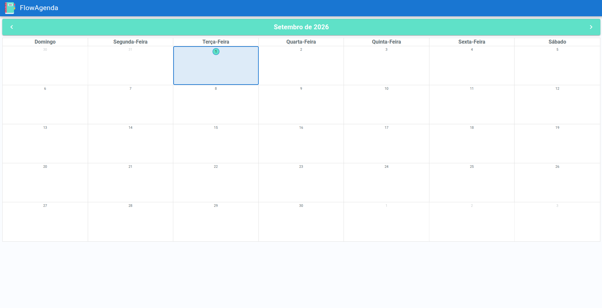

# FlowAgenda

Aplicação de agenda desenvolvida com Vue.js e Quasar Framework, utilizando os componentes `QCalendarMonth` e `QCalendarDay` para visualização e gerenciamento de eventos.

O FlowAgenda permite criar, visualizar, editar e excluir eventos, além de possibilitar a seleção de múltiplas datas para eventos repetidos.

A aplicação possui uma interface responsiva, adaptada para diferentes tamanhos de tela.

---



---

## 📋 Sobre o projeto

O FlowAgenda é uma aplicação de agenda/calendário desenvolvida para praticar e demonstrar conceitos de desenvolvimento Front-end utilizando Vue.js e Quasar Framework.

A aplicação possui duas visualizações principais:

- **Calendário mensal**, utilizando `QCalendarMonth`
- **Calendário diário**, utilizando `QCalendarDay`

A partir do calendário, o usuário pode selecionar uma data e gerenciar seus eventos.

Os dados são persistidos utilizando uma API local criada com JSON Server.

---

## ✨ Funcionalidades

- Visualização mensal dos eventos
- Visualização diária dos eventos
- Criação de eventos
- Edição de eventos
- Exclusão de eventos
- Seleção de múltiplas datas
- Criação de eventos em datas repetidas
- Exclusão de datas específicas de um evento repetido
- Exclusão de todas as datas de um evento repetido
- Definição de evento para o dia inteiro
- Definição de horário de início e término
- Validação dos horários dos eventos
- Adição de localização ao evento
- Interface responsiva
- Navegação entre meses
- Retorno rápido para o mês atual

---

## 🛠️ Tecnologias

### Front-end

- [Vue.js](https://vuejs.org/)
- [Quasar Framework](https://quasar.dev/)
- [Quasar QCalendar](https://github.com/quasarframework/quasar-ui-qcalendar)
  - `QCalendarMonth`
  - `QCalendarDay`
- Sass
- Axios

### API / Desenvolvimento

- JSON Server
- Concurrently

### Ferramentas

- Vite
- ESLint
- Prettier
- Node.js
- npm

---

## 📦 Pré-requisitos

Antes de começar, você precisa ter instalado:

- Node.js
- npm

A versão de Node.js utilizada pelo projeto é:

```text
Node.js >= 26
ou
Node.js 24
ou
Node.js >= 22.12
```

---

## 🚀 Instalação

Clone o repositório:
git clone <https://github.com/giosantos99/flow-agenda.git>

Entre na pasta do projeto:
cd FlowAgenda

Instale as dependências:
npm install

---

## 🔑 Variáveis de Ambiente

O projeto utiliza a API do Geoapify para a busca com autocomplete de localizações no formulário.

1. Crie um arquivo chamado .env na raiz do projeto (copie como base o arquivo .env.example):
  cp .env.example .env

2. Obtenha uma chave de API gratuita cadastrando-se em [Geoapify](https://www.geoapify.com/).

3. Abra o arquivo .env gerado e defina a sua chave na variável:
  VITE_GEOAPIFY_API_KEY=sua_chave_aqui

Nota: As variáveis de ambiente carregadas pelo Vite no front-end precisam obrigatoriamente do prefixo VITE_.

---

## ▶️ Executando o projeto

O projeto possui dois processos que precisam estar em execução:
- Aplicação Vue/Quasar;
- JSON Server, responsável pela API local.

Opção 1 — Executar tudo simultaneamente

  O projeto possui um script que inicia os dois processos:
  npm run dev:all

  A aplicação será executada pelo Quasar e o JSON Server será iniciado automaticamente.

Opção 2 — Executar separadamente

  Terminal 1: npm run dev
  Terminal 2: npm run api

---

## 🗄️ API

O projeto utiliza o JSON Server como uma API local para desenvolvimento.

O banco utilizado pela aplicação está localizado em: db/db.json

A estrutura inicial do arquivo é:
{
  "eventos": [],
  "$schema": "./node_modules/json-server/schema.json"
}

A API disponibiliza os eventos através do endpoint: /eventos

A aplicação utiliza Axios para realizar as requisições HTTP.

Exemplos de operações:

GET     /eventos
POST    /eventos
PATCH   /eventos/:id
DELETE  /eventos/:id

---

## 📅 Calendário

O FlowAgenda utiliza o Quasar QCalendar para as visualizações do calendário.

- QCalendarMonth

Responsável pela visualização mensal:
Janeiro 2026

Seg  Ter  Qua  Qui  Sex  Sáb  Dom
        1    2    3    4    5
 6    7    8    9   10   11   12
...

Os dias que possuem eventos exibem a quantidade de eventos cadastrados.

- QCalendarDay

Responsável pela visualização diária dos eventos.

Os eventos possuem posicionamento baseado no horário de início e término.

Eventos que acontecem no mesmo período são posicionados lado a lado para facilitar a visualização.

---

## 🔁 Eventos repetidos

O FlowAgenda permite selecionar múltiplas datas para criar um mesmo evento.

Por exemplo:

25/08/2026
26/08/2026
27/08/2026

O usuário pode criar o evento e selecionar as datas desejadas para suas ocorrências.

Também é possível adicionar ou remover datas posteriormente.

---

## 📱 Responsividade

A interface foi desenvolvida utilizando os recursos de responsividade do Quasar Framework.

O layout se adapta a diferentes tamanhos de tela, incluindo:

Desktop
Tablet
Dispositivos móveis

Componentes como drawers, botões, calendários e formulários utilizam classes e recursos responsivos do Quasar.

---

## 👩‍💻 Desenvolvedora

Giovanna Santos de Souza

Desenvolvedora Front-end
